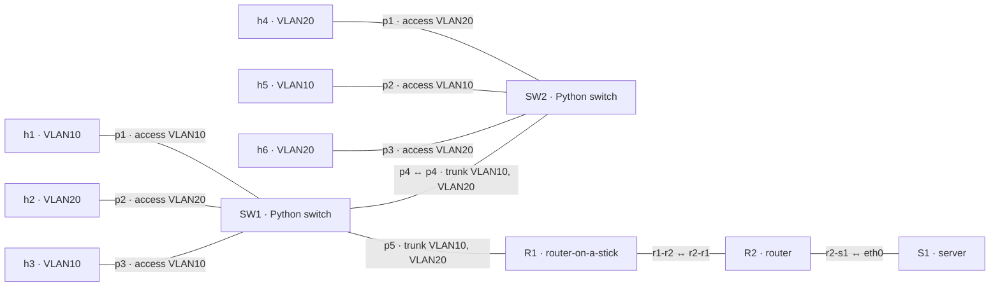

# Network Architecture

> **At a glance:** 11 network namespaces · 6 hosts · 2 Python switches · 2 routers · 1 server · VLAN10 and VLAN20

This page is a quick reference to the lab topology and traffic paths. Namespace links and base IPv4 addressing come from [`topology/setup_h.sh`](./topology/setup_h.sh); router VLAN interfaces and host default gateways come from [`topology/r1_subif_r.sh`](./topology/r1_subif_r.sh). Switch port roles and VLAN membership are defined in [`switch/config_sw1_d.json`](./switch/config_sw1_d.json) and [`switch/config_sw2_d.json`](./switch/config_sw2_d.json).

## 1. Topology

**Reading the diagram:** access links carry untagged host frames; the SW1–SW2 and SW1–R1 trunks carry tagged VLAN10 and VLAN20 traffic. R1's `r1-sw.10` and `r1-sw.20` subinterfaces provide the host VLAN gateways.

## 2. Devices and namespaces

| Namespace(s) | Device role | Interfaces / notes |
|---|---|---|
| `h1`–`h6` | End hosts | Each host uses `eth0` and connects to one switch access port. |
| `sw1`, `sw2` | Python learning switches | `switch/switch_d.py` opens a raw packet socket on each configured port. |
| `r1` | VLAN gateway and router | `r1-sw` connects to SW1; VLAN interfaces are `r1-sw.10` and `r1-sw.20`; `r1-r2` connects to R2. |
| `r2` | Router to server network | `r2-r1` connects to R1; `r2-s1` connects to S1. |
| `s1` | Server host | Uses `eth0` on the `10.0.30.0/24` network. |

## 3. Addressing

### Host interfaces

| Host | Switch port | VLAN | IPv4 address | MAC address | Default gateway |
|---|---|---:|---|---|---|
| h1 | SW1 p1 | 10 | `192.168.10.11/24` | `02:00:00:00:00:01` | `192.168.10.1` |
| h2 | SW1 p2 | 20 | `192.168.20.11/24` | `02:00:00:00:00:02` | `192.168.20.1` |
| h3 | SW1 p3 | 10 | `192.168.10.12/24` | `02:00:00:00:00:03` | `192.168.10.1` |
| h4 | SW2 p1 | 20 | `192.168.20.12/24` | `02:00:00:00:00:04` | `192.168.20.1` |
| h5 | SW2 p2 | 10 | `192.168.10.13/24` | `02:00:00:00:00:05` | `192.168.10.1` |
| h6 | SW2 p3 | 20 | `192.168.20.13/24` | `02:00:00:00:00:06` | `192.168.20.1` |

### Networks and router interfaces

| Network / purpose | IPv4 subnet | Configured interface addresses |
|---|---|---|
| VLAN10 | `192.168.10.0/24` | R1 `r1-sw.10`: `192.168.10.1/24`; hosts h1 `.11`, h3 `.12`, h5 `.13` |
| VLAN20 | `192.168.20.0/24` | R1 `r1-sw.20`: `192.168.20.1/24`; hosts h2 `.11`, h4 `.12`, h6 `.13` |
| R1–R2 transit | `10.0.12.0/30` | R1 `r1-r2`: `10.0.12.1/30`; R2 `r2-r1`: `10.0.12.2/30` |
| R2–S1 server network | `10.0.30.0/24` | R2 `r2-s1`: `10.0.30.1/24`; S1 `eth0`: `10.0.30.10/24` |

The host MAC addresses are assigned explicitly in `topology/setup_h.sh`. The router, switch, and server interface MAC addresses are not set there.

## 4. Switch port map

**Access** ports assign untagged ingress frames to one configured VLAN and send untagged frames on egress. **Trunk** ports accept and emit 802.1Q-tagged frames for the VLANs in their allow-list.

### SW1

| Port | Mode | VLAN membership | Connected peer |
|---|---|---|---|
| `p1` | Access | VLAN10 | h1 `eth0` |
| `p2` | Access | VLAN20 | h2 `eth0` |
| `p3` | Access | VLAN10 | h3 `eth0` |
| `p4` | Trunk | VLAN10, VLAN20 | SW2 `p4` |
| `p5` | Trunk | VLAN10, VLAN20 | R1 `r1-sw` |

### SW2

| Port | Mode | VLAN membership | Connected peer |
|---|---|---|---|
| `p1` | Access | VLAN20 | h4 `eth0` |
| `p2` | Access | VLAN10 | h5 `eth0` |
| `p3` | Access | VLAN20 | h6 `eth0` |
| `p4` | Trunk | VLAN10, VLAN20 | SW1 `p4` |

Both switch configurations set the MAC-table aging interval to **300 seconds**.

## 5. How traffic moves

1. **ARP discovery:** an ARP request is a broadcast. The switch learns the sender's source MAC and floods the request to eligible ports in the same VLAN, excluding the ingress port. The target host replies to the requester; ARP observation and the learned MAC table provide the return-port information.
2. **Learned same-VLAN unicast:** the switch looks up a known destination by `(VLAN, MAC)` and sends the frame only to the destination's learned port. A destination on the ingress port is not forwarded back out that port.
3. **VLAN trunking:** trunk ingress requires an allowed 802.1Q tag. The switch removes the tag while processing the frame and adds the VLAN tag again when sending to an allowed trunk. Access egress remains untagged.
4. **Inter-VLAN routing:** with the R1 VLAN subinterfaces configured and IPv4 forwarding enabled, a host sends cross-subnet traffic to its VLAN gateway. The tagged frame reaches R1 through SW1 `p5`; R1 routes it between `r1-sw.10` and `r1-sw.20`.
5. **Routed path to S1:** traffic from h1 to `10.0.30.10` passes through SW1, R1, the R1–R2 transit network `10.0.12.0/30`, R2, and the server network `10.0.30.0/24`. The setup script installs the R1 route to S1's network, R2's return routes to both VLANs, and S1's default route.
6. **E4 error-detection path:** [`experiments/e4_errors_h.py`](./experiments/e4_errors_h.py) creates a separate source → noisy-link → receiver path in namespaces `e4src`, `e4mid`, and `e4dst`. [`errors/generator_h.py`](./errors/generator_h.py) sends custom frames, [`errors/noisy_link_h.py`](./errors/noisy_link_h.py) introduces single-bit, double-bit, or burst corruption, and [`errors/receiver_h.py`](./errors/receiver_h.py) checks parity, the Internet checksum, and CRC-32.
