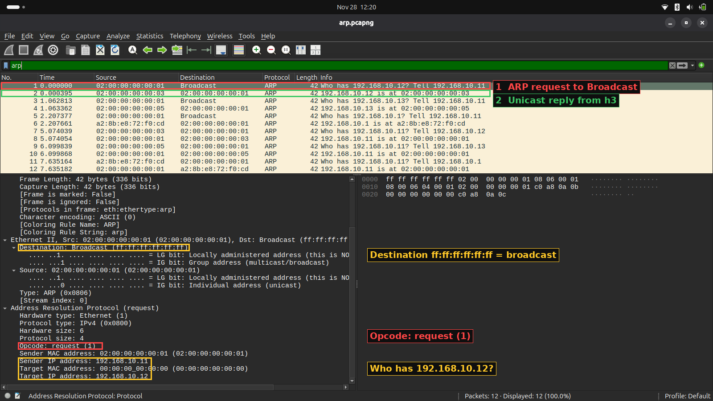
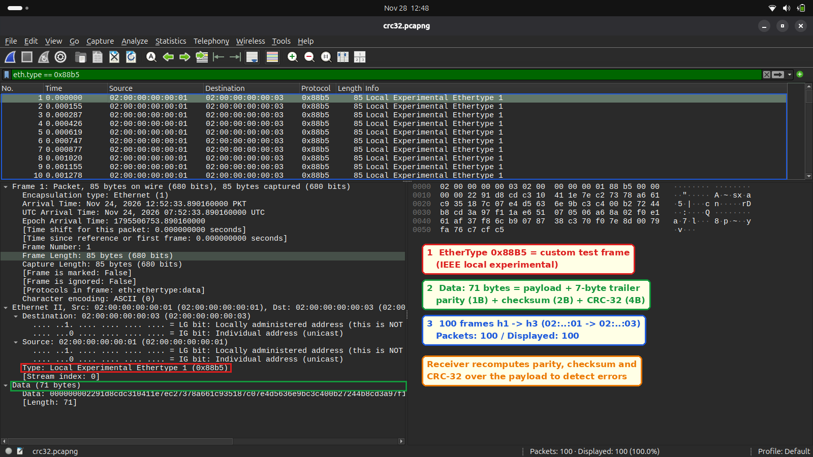
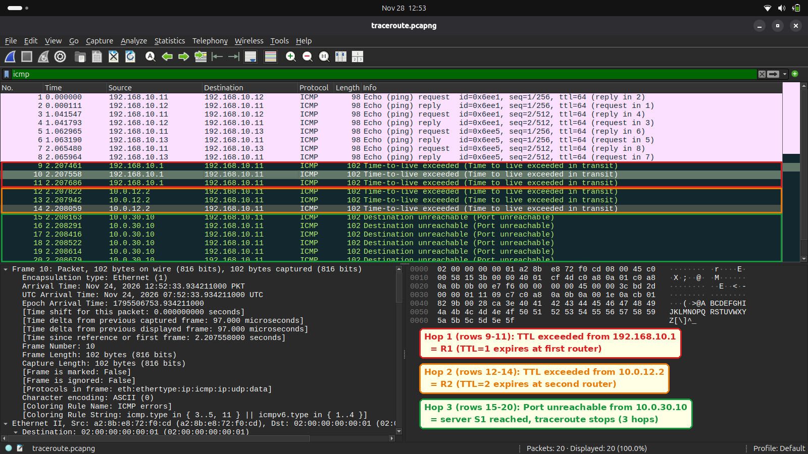
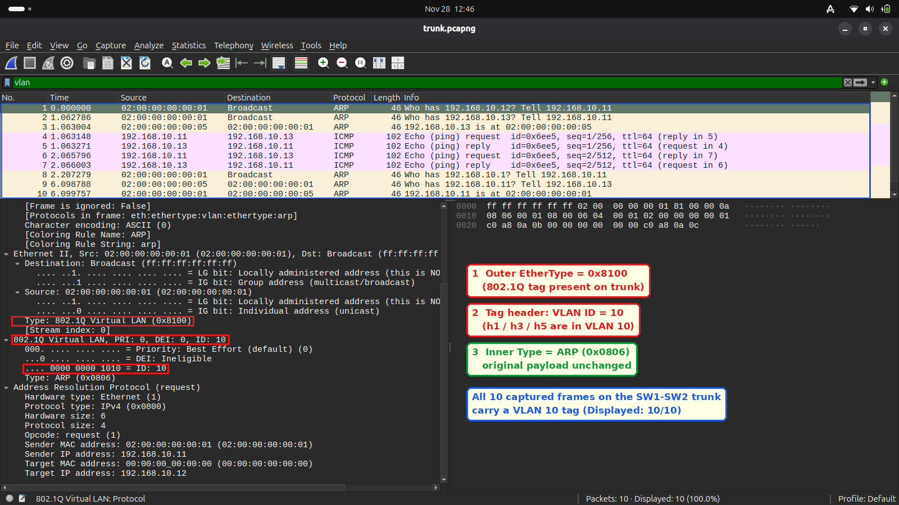

# CS3001 Project 30: Software Ethernet Switch

This repository implements and evaluates a user-space Ethernet learning switch, VLAN access and trunk behavior, router-on-a-stick forwarding, routed links, error-detection codes, and packet captures. Experiments E1–E5 have CSV results in `results/`; pcapng examples are in `captures/`. The isolated lab uses Linux network namespaces, virtual Ethernet pairs, and raw packet sockets.

## Team file ownership

Ownership is indicated by the filename suffix used in the project files.

| Suffix | Member |
|---|---|
| `_h` | Abdullah (24K-0532) |
| `_d` | Mashhood Riaz (24K-0530) |
| `_r` | Mukhtar (24K-0511) |

## Team responsibilities

The proposal assigns the project work as follows:

| Member | Assigned implementation and validation |
|---|---|
| Mashhood Riaz (24K-0530) | F1–F3: MAC learning/aging, flooding/forwarding, and ARP handling; E1/E2 scripts, Linux bridge baseline, and switch report sections. |
| Mukhtar (24K-0511) | F4–F5: VLAN access/isolation, trunk ports, and the second switch; R1 subinterfaces, E5 tests, and README. |
| Abdullah (24K-0532) | F6–F8: noisy link, CRC-32 generator/receiver, parity, and checksum; R1/R2/S1 topology and traffic-control scripts, E3/E4, captures, and Wireshark screenshots. |

The proposal also states that all members contribute to the report and live demo and check one another's code. See [AI_USE_DISCLOSURE.md](./AI_USE_DISCLOSURE.md) for the disclosure and individual contribution summary.

## Repository layout

| Path | Contents |
|---|---|
| `topology/` | Namespace and link setup/teardown, router subinterfaces and forwarding, link impairment |
| `switch/` | Python switch, VLAN handling, MAC learning, ARP logging, switch configurations |
| `errors/` | Parity, Internet checksum, CRC-32, frame generator, noisy link, receiver |
| `experiments/` | E1–E5 runners, Linux bridge baseline, analyzer, capture script |
| `tests/` | Error-code unit tests and raw-frame diagnostic |
| `results/` | E1–E5 CSV results and analyzer summary |
| `captures/` | ARP, trunk, CRC-32 test-frame, and traceroute pcapng files |
| `annotated_screenshots/` | Annotated Wireshark screenshots for ARP, CRC-32, traceroute, and trunk traffic |
| `CS3001_Project30-Proposal_0530,0511,0532.pdf` | Project proposal with team roll numbers and responsibilities |
| `demo_r.sh`, `requirements.sh` | Interactive demo and Ubuntu package installer |

See [ARCHITECTURE.md](./ARCHITECTURE.md) for topology and addressing details, [REPORT.md](./REPORT.md) for the results, and [AI_USE_DISCLOSURE.md](./AI_USE_DISCLOSURE.md) for the AI-use and student-verification statements.

## Network design

`topology/setup_h.sh` creates 11 namespaces and their virtual Ethernet links. The switches are Linux namespaces that run the project Python switch; veth pairs act as their links.

```text
 h1 (VLAN10) ──┐                         ┌── h4 (VLAN20)
 h2 (VLAN20) ──┼── SW1 ═══ trunk ═══ SW2 ┼── h5 (VLAN10)
 h3 (VLAN10) ──┘    │                    └── h6 (VLAN20)
                    │ trunk
                   R1 ── routed link ── R2 ── S1
```

| Device / port | Role and VLAN | Address or peer |
|---|---|---|
| SW1 p1 | Access VLAN10 | h1 `eth0` |
| SW1 p2 | Access VLAN20 | h2 `eth0` |
| SW1 p3 | Access VLAN10 | h3 `eth0` |
| SW1 p4 | Trunk VLAN10, VLAN20 | SW2 p4 |
| SW1 p5 | Trunk VLAN10, VLAN20 | R1 `r1-sw` |
| SW2 p1 | Access VLAN20 | h4 `eth0` |
| SW2 p2 | Access VLAN10 | h5 `eth0` |
| SW2 p3 | Access VLAN20 | h6 `eth0` |
| SW2 p4 | Trunk VLAN10, VLAN20 | SW1 p4 |

| Segment | IPv4 network and endpoints |
|---|---|
| VLAN10 | `192.168.10.0/24`: R1 `192.168.10.1`, h1 `.11`, h3 `.12`, h5 `.13` |
| VLAN20 | `192.168.20.0/24`: R1 `192.168.20.1`, h2 `.11`, h4 `.12`, h6 `.13` |
| R1–R2 | `10.0.12.0/30`: R1 `10.0.12.1`, R2 `10.0.12.2` |
| R2–S1 | `10.0.30.0/24`: R2 `10.0.30.1`, S1 `10.0.30.10` |

Host MAC addresses are assigned as `02:00:00:00:00:01` through `02:00:00:00:00:06` for h1 through h6. SW1 and SW2 access/trunk roles and VLAN memberships are defined by [switch/config_sw1_d.json](./switch/config_sw1_d.json) and [switch/config_sw2_d.json](./switch/config_sw2_d.json). See [ARCHITECTURE.md](./ARCHITECTURE.md) for the complete namespace, address, and communication-flow description.

## Prerequisites

Use Ubuntu or a compatible Linux system with `sudo` access. The lab requires Python 3, Scapy, `iproute2`, `iperf3`, `tcpdump`, `ethtool`, and `traceroute`. Wireshark is needed to view pcapng files; the capture-generation script also uses `dumpcap` and `capinfos`.

Install the repository's listed packages from the root:

```sh
sudo bash requirements.sh
```

The installer also installs `python3-pip` and `bridge-utils`.

## Create and remove the lab

To create the base topology for manual inspection, run these from the repository root:

```sh
sudo ./topology/setup_h.sh
sudo ./topology/r1_subif_r.sh
sudo ./topology/r1_forward_r.sh on
```

The setup script first removes existing namespaces that use this project's names, then creates the namespaces, veth pairs, host/router addresses, routes, and forwarding configuration. It disables IPv6 inside the lab, disables common NIC offloads where supported, brings interfaces up, and checks link and routed connectivity. The R1 subinterface script creates VLAN10 and VLAN20 gateways and points the hosts' default routes at them. The forwarding script accepts `on` or `off`, which is used by the E5 isolation experiment.

Clean up the project topology with:

```sh
sudo ./topology/teardown_h.sh
```

This removes the project namespaces and their veth links. Do not use the project namespace names for unrelated work. Experiment runners create the topology they need, so a separate setup is not required before running E1–E5.

## Run order

Run commands from the repository root. Times are approximate and machine-dependent; E4 runtime is especially dependent on the host.

| Step | Command | Approximate duration |
|---|---|---|
| Create the lab topology | `sudo ./topology/setup_h.sh` | Under a minute on a responsive host |
| Live demo | `sudo bash demo_r.sh` | About 5–10 minutes, depending on pauses between its stages |
| E1: learning/flooding | `sudo ./experiments/e1_learning_d.sh` | About 2–3 minutes |
| E2: switch/bridge throughput | `sudo ./experiments/e2_bridge_vs_switch_d.sh` | At least 9 minutes for the timed throughput tests, plus setup |
| E3: routed-link delay | `sudo ./experiments/e3_routed_h.sh` | At least 4.5 minutes for the timed throughput tests, plus setup |
| E4: error detection | `sudo python3 experiments/e4_errors_h.py` | Generator pacing alone is about 23 seconds total; overall time [TO CONFIRM] |
| E5: VLAN isolation | `sudo ./experiments/e5_vlan_isolation_r.sh` | About 1–2 minutes |
| Summarize CSV results | `python3 experiments/analyze_h.py` | Usually under a minute |
| Generate captures | `sudo ./experiments/captures_h.sh` | Usually under a minute |
| Run unit tests | `PYTHONPATH=. python3 tests/test_codes_h.py` | Usually under a minute |

The approximate E2 and E3 lower-bound estimates follow the script's thirty-second `iperf3` tests: E2 has three rates, two forwarding implementations, and three runs; E3 has three delay settings and three runs. E1–E5 runners recreate the topology they need; E4 creates its own temporary namespaces. The standalone topology setup is useful for manual work, but experiments do not require it to remain running. The live demo also creates and cleans up its own lab.

The experiment CSVs are rewritten by their runners. Run E1 through E5 before the analyzer; it reads `results/e1.csv` through `results/e5.csv` and writes `results/summary.csv`.

### What each experiment measures

| Experiment | Conditions | Measurements and notes |
|---|---|---|
| E1 — learning/flooding | 2, 4, and 6 active hosts; 3 runs per condition | `flooded_frame_ratio` is sampled over time; `learning_time_seconds` records when forwarding is observed. |
| E2 — Python switch vs Linux bridge | 10 Mbit/s, 100 Mbit/s, and unlimited; each mode/rate has 3 runs | TCP throughput from 30-second `iperf3` tests, ping RTT, and CPU percentage. The Python process CPU is measured for the switch; bridge CPU is a system-wide estimate. |
| E3 — routed path | R1–R2 delays of 20 ms, 100 ms, and 200 ms; 3 runs per delay | H1-to-S1 ping RTT, TCP throughput, and traceroute hop count. |
| E4 — error detection | Single-bit, double-bit, and 8–32-bit burst corruption; 3 runs per condition | 100,000 generated frames per run; parity, Internet-checksum, and CRC-32 detection rates and missed frames. |
| E5 — VLAN isolation | Same VLAN over trunk; cross-VLAN with R1 forwarding off and on; 3 runs per case | Ping outcome and frames observed on the VLAN20 access link while checking for leakage. |

The E1, E2, E3, and E5 scripts rebuild the main namespaces before their measurements. E4 uses and removes its own temporary namespaces (`e4src`, `e4mid`, and `e4dst`). The runners overwrite their corresponding `results/eN.csv` file. Treat these tracked CSVs as snapshots of experiment runs, and copy any data you need before rerunning an experiment.

## Run the Python switches manually

When using the lab outside the experiment scripts, start one process per switch in separate terminals:

```sh
sudo ip netns exec sw1 python3 switch/switch_d.py --config switch/config_sw1_d.json
sudo ip netns exec sw2 python3 switch/switch_d.py --config switch/config_sw2_d.json
```

The switch learns a source MAC on ingress, keyed by VLAN, and forwards known unicast to the learned port. Broadcast, multicast, and unknown unicast frames are flooded only to eligible ports in the same VLAN. Access ports accept and emit untagged traffic for their configured VLAN. Trunks accept and emit 802.1Q frames for configured VLANs. The default MAC aging time in both configurations is 300 seconds.

Useful diagnostic options:

```sh
sudo ip netns exec sw1 python3 switch/switch_d.py \
  --config switch/config_sw1_d.json --aging 10 --verbose \
  --stats results/switch.csv
```

- `--aging` selects a positive MAC-entry aging time.
- `--verbose` reports learning, aging, forwarding, flooding, and dropped frames.
- `--stats` writes one-second `time,flooded,forwarded,total` counters.
- Sending `SIGUSR1` to the switch process prints its current VLAN/MAC/port table.

Stop manually started switch processes before replacing them with Linux bridges or tearing down namespaces.

## E4 frame format

E4 sends custom Ethernet frames using EtherType `0x88B5`. The protected payload starts with a 4-byte sequence number and contains 60 pseudorandom bytes. The generator appends one even-parity byte, a 16-bit Internet checksum, and a 32-bit CRC-32. The noisy link forwards only these test frames and corrupts protected data for the selected mode. A per-run seed is recorded by the runner to make generation and corruption repeatable. The receiver independently checks each code and reports detection and missed-frame counts.

The implementations are in [errors/codes_h.py](./errors/codes_h.py), [errors/generator_h.py](./errors/generator_h.py), [errors/noisy_link_h.py](./errors/noisy_link_h.py), and [errors/receiver_h.py](./errors/receiver_h.py).

## Captures

The saved examples are `captures/arp.pcapng`, `captures/trunk.pcapng`, `captures/crc32.pcapng`, and `captures/traceroute.pcapng`. Open them in Wireshark, or inspect a capture with `tcpdump -nn -r captures/arp.pcapng`. To regenerate the set, run the capture script above.

### Annotated Wireshark screenshots

These annotated views correspond to the saved pcapng examples:

| ARP request/reply | CRC-32 test frames |
|---|---|
|  |  |

| Routed traceroute | VLAN trunk tag |
|---|---|
|  |  |

If `dumpcap` cannot write under `captures/`, capture with `tcpdump` instead. For example, the demo's trunk capture uses this repository-verified command form:

```sh
sudo ip netns exec sw1 tcpdump -Q out -enn -i p4 -c 1 -w /tmp/cs3001-trunk.pcap vlan
```

The capture script writes the four pcapng files under `captures/`: ARP on SW1 p1, tagged traffic on SW1 p4, custom `0x88B5` frames, and ICMP traffic from the routed traceroute. It uses `dumpcap` and `capinfos`; the saved annotated Wireshark views above are for examining the corresponding fields.

## Interactive demo

Run the nine-stage presentation with root privileges:

```sh
sudo bash demo_r.sh
```

The demo creates and removes its own lab. It demonstrates setup verification, access-VLAN connectivity, tagged trunk versus untagged access traffic, ARP/MAC learning, unknown-destination flooding, MAC aging, the routed path, E4 error detection, and throughput through the Python switch and Linux bridge. It pauses between stages when attached to a terminal and reports a pass/fail summary. The recorded video is included as [demo_video.mp4](./demo_video.mp4); the Drive submission URL is in [GCR_SUBMISSION.txt](./GCR_SUBMISSION.txt).

## Troubleshooting

- **Root privileges:** topology, demo, experiment, switch, and packet-capture commands need root; run them with `sudo`.
- **Stale project namespaces:** remove them with `sudo bash topology/teardown_h.sh`, then retry the setup or experiment.
- **Leftover processes:** check for old `switch_d.py`, `tcpdump`, or `iperf3` processes with `ps`; stop only the identified process IDs with `kill PID`. The experiments rebuild the topology themselves, so a manually running lab or old switch can conflict.
- **Capture permissions:** `dumpcap` must be allowed to write into `captures/`. Use `tcpdump` for a capture when that permission is unavailable, or run the capture command with `sudo`.
- **Unexpected repeat-run state:** the topology setup starts by tearing down namespaces with the project's names. Do not use those namespace names for unrelated work.

## Tests

`tests/test_codes_h.py` validates CRC-32 against Python's `zlib`, checks Internet-checksum verification, and checks single-bit parity detection. `tests/raw_check_d.py` is a separate raw-frame diagnostic and expects a running topology.

Run the raw-frame diagnostic against a switch port while the topology is active:

```sh
sudo ip netns exec sw1 python3 tests/raw_check_d.py p1 10
```

It prints the destination MAC, source MAC, and EtherType for each received frame. The error-code unit tests do not create namespaces and can be run without root.

## Linux bridge baseline

E2 uses `experiments/bridge_baseline_d.sh` to replace the user-space switches with VLAN-aware Linux bridges. For manual inspection, first stop both switch processes, then run:

```sh
sudo ./experiments/bridge_baseline_d.sh start
sudo ./experiments/bridge_baseline_d.sh stop
```

The `start` action creates `br0` in the SW1 and SW2 namespaces, enables VLAN filtering, and configures the access/trunk membership. The `stop` action removes the bridges.

## Course deliverables

The submitted proposal is [CS3001_Project30-Proposal_0530,0511,0532.pdf](./CS3001_Project30-Proposal_0530,0511,0532.pdf). The five-page report is available as [REPORT.md](./REPORT.md) and [REPORT.pdf](./REPORT.pdf). Proposal-based member contributions, AI use, and student verification are recorded in [AI_USE_DISCLOSURE.md](./AI_USE_DISCLOSURE.md).
