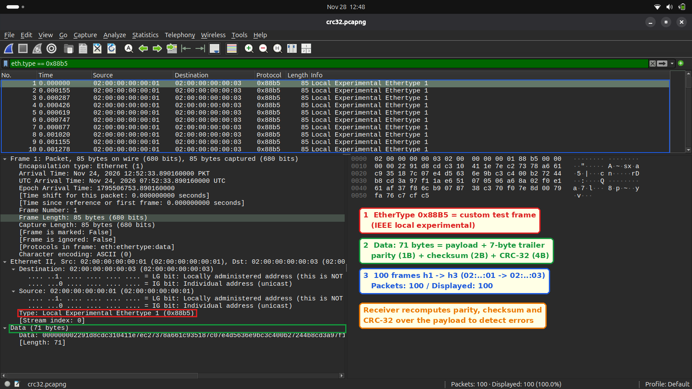
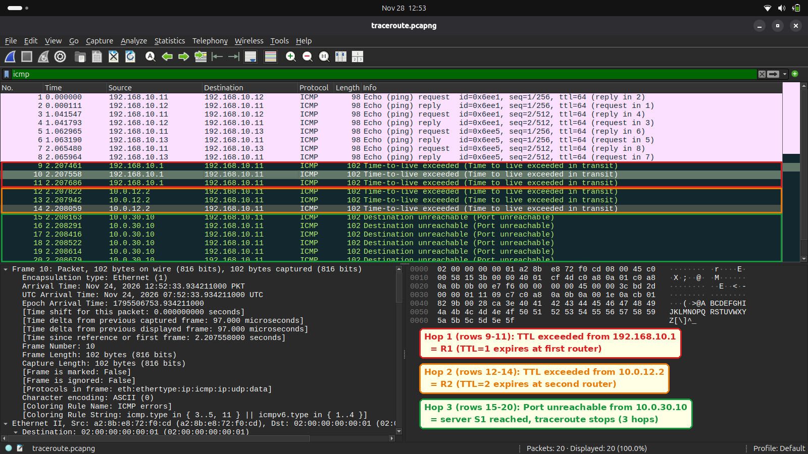
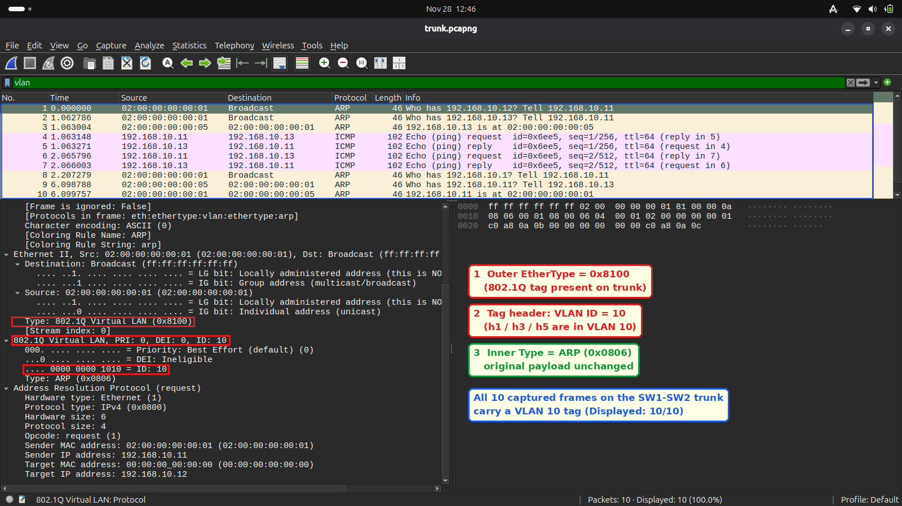

# Project 30 Software Ethernet Switch

**CS3001 Computer Networks — Fall 2026**<br>
**Instructor:** Dr Ghufran Ahmed<br>
**Group:** 11<br>
**Mashhood Riaz:** 24K-0530<br>
**Abdullah:** 24K-0532<br>
**Mukhtar:** 24K-0511

## Abstract

This project implements a Python user-space Ethernet learning switch and tests VLAN access/trunk behavior, routed connectivity, forwarding performance, and error-detection codes in Linux network namespaces. Five experiments compare learning/flooding, a Python switch with a Linux bridge, routed-link delay, parity/checksum/CRC detection, and VLAN isolation. The reported values are the three-run results in `results/e1.csv` through `results/e5.csv`; means and sample standard deviations are used where applicable. At rate limits of 10 and 100 Mbit/s the Python switch throughput is close to the bridge, while its unlimited throughput is substantially lower. CRC-32 detected every tested error in E4.

## Objectives

- Implement source-MAC learning, aging, known-unicast forwarding, and VLAN-scoped flooding.
- Carry VLAN10 and VLAN20 across 802.1Q trunks and route between them using R1 subinterfaces.
- Reach the S1 network through R1 and R2, and measure link-delay and throughput effects.
- Compare parity, Internet checksum, and CRC-32 under single, double, and burst corruption.
- Validate the implementation with repeatable CSV experiments, unit tests, and packet captures.

## Architecture and addressing

`topology/setup_h.sh` creates namespaces h1–h6, SW1, SW2, R1, R2, and S1. SW1 connects h1/h2/h3 and trunks to SW2 and R1; SW2 connects h4/h5/h6. VLAN10 is `192.168.10.0/24` and VLAN20 is `192.168.20.0/24`. R1 subinterfaces are `192.168.10.1/24` and `192.168.20.1/24`. R1–R2 uses `10.0.12.0/30`; R2–S1 uses `10.0.30.0/24`. Host interface addresses and the complete port map are in [ARCHITECTURE.md](./ARCHITECTURE.md).

## Implementation

`switch/switch_d.py` receives AF_PACKET frames, restores VLAN metadata when available, learns `(VLAN, source MAC, port)` entries, ages them, forwards learned unicast, and VLAN-scopes flooding. `switch/vlan_r.py` validates access/trunk ingress and removes or adds 802.1Q tags on ingress/egress. `switch/arp_log_d.py` records sender IP/MAC information and helps direct ARP replies. `topology/r1_subif_r.sh` configures router-on-a-stick interfaces; `topology/r1_forward_r.sh` controls IPv4 forwarding.

E4 appends and checks even parity, the 16-bit Internet checksum, and CRC-32. The generator and receiver encode/decode these checks around a custom EtherType frame, while the noisy link modifies the protected payload for the selected error condition.

## Methodology

Each E1–E5 condition has three runs in the saved result CSVs. Values below are reported as mean ± sample standard deviation (`statistics.stdev`, as in the repository analyzer). E1 flooded-frame ratio is averaged over each run's one-second samples first, then summarized over its three run means. E4 reports detection-rate summaries; E5 uses the three binary ping outcomes and recorded leaked-frame counts.

## Results

### E1 — MAC learning and flooding

Flooded-frame ratio by active-host count; learning time is also averaged over the three runs.

| Active hosts | Flooded-frame ratio, run mean ± SD | Learning time (s), mean ± SD |
|---:|---:|---:|
| 2 | 0.2857 ± 0.0000 | 1.000 ± 0.000 |
| 4 | 0.2141 ± 0.0138 | 1.000 ± 0.000 |
| 6 | 0.1966 ± 0.0292 | 1.333 ± 0.577 |

### E2 — Python switch vs Linux bridge

Throughput in Mbit/s, ping RTT in ms, and the recorded CPU percentage.

| Rate | Forwarder | Throughput | RTT | CPU |
|---|---|---:|---:|---:|
| 10 Mbit/s | Python | 9.553 ± 0.003 | 0.312 ± 0.075 | 11.367 ± 0.306 |
| 10 Mbit/s | Linux bridge | 9.548 ± 0.007 | 0.058 ± 0.010 | 34.433 ± 8.656 |
| 100 Mbit/s | Python | 95.583 ± 0.059 | 0.263 ± 0.017 | 54.400 ± 0.656 |
| 100 Mbit/s | Linux bridge | 95.632 ± 0.005 | 0.056 ± 0.008 | 16.334 ± 9.135 |
| Unlimited | Python | 287.209 ± 3.657 | 0.329 ± 0.021 | 84.733 ± 1.553 |
| Unlimited | Linux bridge | 4313.050 ± 428.901 | 0.058 ± 0.013 | 59.265 ± 6.205 |

### E3 — R1–R2 delay

| Configured delay | Ping RTT (ms) | Throughput (Mbit/s) | Traceroute hops |
|---:|---:|---:|---:|
| 20 ms | 20.633 ± 0.247 | 77.520 ± 16.504 | 3.000 ± 0.000 |
| 100 ms | 100.467 ± 0.063 | 48.442 ± 16.856 | 3.000 ± 0.000 |
| 200 ms | 200.403 ± 0.073 | 25.241 ± 3.909 | 3.000 ± 0.000 |

### E4 — Error detection

Detection rate (%), mean ± sample standard deviation across three runs.

| Error condition | Parity | Internet checksum | CRC-32 |
|---|---:|---:|---:|
| Single-bit | 100.000 ± 0.000 | 100.000 ± 0.000 | 100.000 ± 0.000 |
| Double-bit | 0.000 ± 0.000 | 96.987 ± 0.021 | 100.000 ± 0.000 |
| Burst | 48.060 ± 0.204 | 99.982 ± 0.009 | 100.000 ± 0.000 |

### E5 — VLAN isolation

| Condition | Ping success (mean ± SD) | Leaked frames (mean ± SD) |
|---|---:|---:|
| Same VLAN over trunk | 1.000 ± 0.000 | 0.000 ± 0.000 |
| Cross-VLAN, R1 forwarding OFF | 0.000 ± 0.000 | 0.000 ± 0.000 |
| Cross-VLAN, R1 forwarding ON | 1.000 ± 0.000 | 0.000 ± 0.000 |

### CSV-derived chart: relative E2 throughput

Each bar is throughput normalized to the Linux bridge at the same rate (bridge = 100%); values are computed from the E2 three-run means.

```text
10 Mbit/s   Python       #################### 100.05%
            Bridge       #################### 100.00%
100 Mbit/s  Python       ####################  99.95%
            Bridge       #################### 100.00%
Unlimited   Python       #                      6.66%
            Bridge       #################### 100.00%
```

## Packet-capture evidence

The saved evidence files are [captures/arp.pcapng](./captures/arp.pcapng), [captures/trunk.pcapng](./captures/trunk.pcapng), [captures/crc32.pcapng](./captures/crc32.pcapng), and [captures/traceroute.pcapng](./captures/traceroute.pcapng). The annotated Wireshark views below show ARP, tagged trunk traffic, custom CRC-32 test frames, and traceroute-related ICMP.

| ARP request/reply | CRC-32 test frames |
|---|---|
|  |  |
| *ARP request is broadcast; reply is unicast.* | *Custom test frame includes payload and error-detection trailer.* |

| Routed traceroute | VLAN trunk tag |
|---|---|
|  |  |
| *Three routed hops are visible in the capture.* | *The 802.1Q header carries VLAN ID 10.* |

## Discussion

E1's flooded-frame ratio has a floor because ARP requests are always broadcast. One six-host sample has a ratio of `0.000`; this is a sampling artifact, not proof that flooding disappears. In E2, CPU percentages for the Linux bridge are only a rough indicator because the bridge measurement is system-wide, unlike the Python-switch process measurement. The Python switch matches the bridge closely when the link is limited at 10 and 100 Mbit/s, but is about 15 times slower when unlimited. In E4, parity detects all tested single-bit errors and no tested double-bit errors; the Internet checksum detects about 97 percent of tested double-bit errors; CRC-32 detects all tested errors. E5 shows same-VLAN trunk reachability, no cross-VLAN reachability with R1 forwarding disabled, and cross-VLAN reachability when it is enabled.

## Limitations

The experiments use Linux virtual Ethernet links and namespace-local measurements, not physical switch hardware. Results depend on the host and the saved CSVs represent only three runs per condition. E1's one-second sampling and E2's approximate bridge CPU measure constrain interpretation. The E4 burst results characterize the implemented random corruption model, not every possible real-world link error. The annotated screenshots are representative views; the pcapng files remain the underlying packet evidence.

## Conclusion

The lab demonstrates VLAN-scoped switching, 802.1Q trunks, router-on-a-stick forwarding, and the routed path to S1. Measured forwarding throughput is similar under the tested 10 and 100 Mbit/s limits, while the Python implementation has lower unlimited throughput than the Linux bridge. Error-detection results show the expected limitation of simple parity on double-bit errors and strong performance by CRC-32 for the tested cases.

## AI-use summary

Claude and an IDE coding assistant were used mainly for learning, planning, and coding assistance, as well as documentation and video-generation assistance. Each member implemented and tested their assigned work and ran through the related experiment steps described in the proposal; the students ran the experiments on their own Linux machine. See [AI_USE_DISCLOSURE.md](./AI_USE_DISCLOSURE.md) for proposal-based individual responsibilities and further details.
