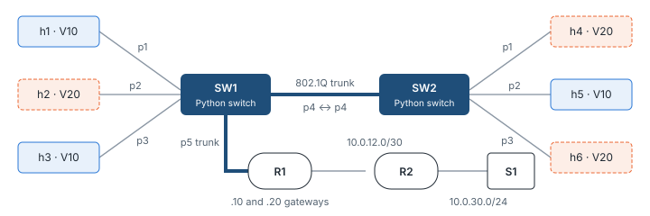
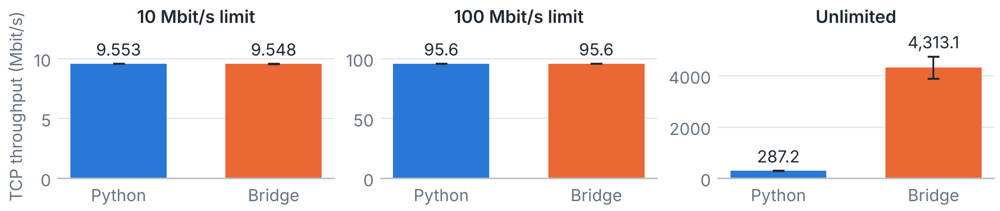
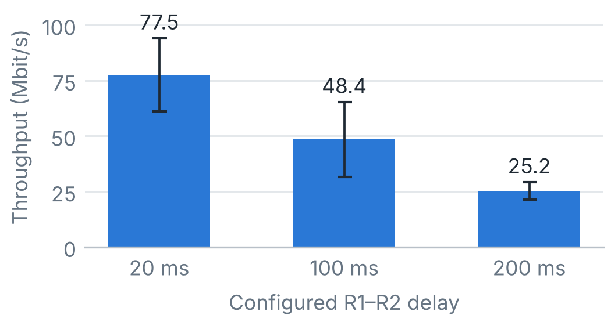
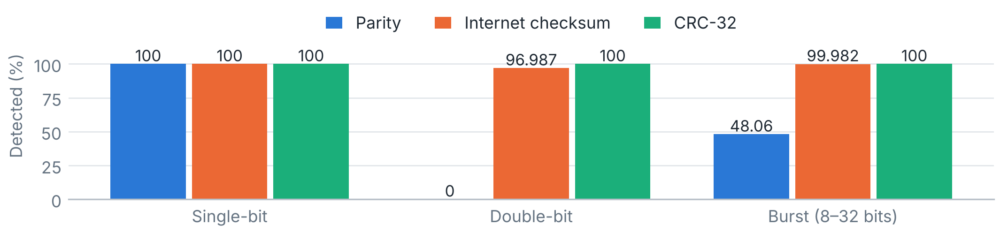
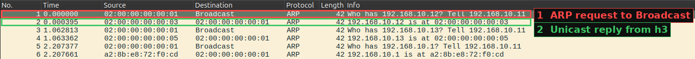
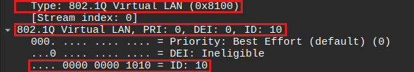
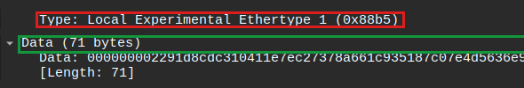
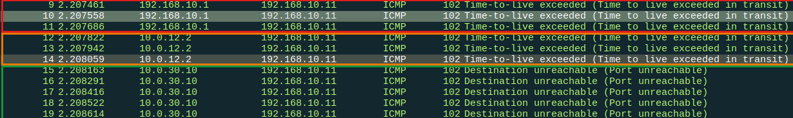

# Software Ethernet Switch: MAC Learning, VLANs, ARP and CRC Error Detection

**CS3001 Computer Networks, Fall 2026 · Project 30 · Group 11 · Instructor: Dr Ghufran Ahmed** 
Mashhood Riaz (24K-0530) · Abdullah (24K-0532) · Mukhtar (24K-0511)

**Abstract.** We built a user-space Ethernet learning switch in Python with 802.1Q VLANs and evaluated it on a Linux network-namespace testbed with two switches, two routers and a server. Five experiments, each run three times per condition, measured MAC learning, performance against the Linux bridge, a delayed routed path, error detection and VLAN isolation. Under 10 and 100 Mbit/s limits the Python switch's mean throughput was within 0.1% of the bridge's; without a limit it reached 287 Mbit/s against 4,313 Mbit/s, a 15-fold gap. CRC-32 detected every injected error, the Internet checksum detected 96.987% of double-bit errors, and parity detected none of them. No frame was recorded leaking between VLANs.

## 1. Introduction and objectives

Operating systems normally hide how a switch chooses an output port, and simple textbook descriptions do not show how much stronger CRC-32 is than parity or the Internet checksum. This project exposes both by implementing them and measuring the results. The objectives were to:

1. Implement source-MAC learning, aging, known-unicast forwarding and VLAN-scoped flooding.
2. Carry VLAN 10 and VLAN 20 over 802.1Q trunks and route between them with router-on-a-stick.
3. Reach a server through two routers and measure the effect of link delay.
4. Compare even parity, the 16-bit Internet checksum and CRC-32 under single-bit, double-bit and burst errors.
5. Compare the Python switch with a VLAN-aware Linux bridge and verify behaviour with packet captures.

## 2. System design

### 2.1 Topology and addressing

`topology/setup_h.sh` creates 11 network namespaces (six hosts, SW1, SW2, R1, R2 and server S1) joined by virtual Ethernet (veth) pairs. IPv6 is disabled and common NIC offloads are turned off where supported.

<figure>

<b>Figure 1.</b> Logical topology. Thick lines are tagged trunks; thin lines to hosts are untagged access links. Solid blue hosts are in VLAN 10, dashed orange hosts in VLAN 20.

</figure>

| Segment | Subnet | Configured addresses |
|---|---|---|
| VLAN 10 | `192.168.10.0/24` | R1 `.1`; h1 `.11`, h3 `.12`, h5 `.13` |
| VLAN 20 | `192.168.20.0/24` | R1 `.1`; h2 `.11`, h4 `.12`, h6 `.13` |
| R1–R2 transit | `10.0.12.0/30` | R1 `.1`; R2 `.2` |
| Server network | `10.0.30.0/24` | R2 `.1`; S1 `.10` |

Host MAC addresses are fixed at `02:00:00:00:00:01` to `:06` (h1 to h6), which makes captures easy to read. R1 uses subinterfaces `r1-sw.10` and `r1-sw.20` as the VLAN gateways. Static routes send R1's server-bound traffic to R2 and R2's VLAN-bound traffic back to R1.

## 3. Implementation

### 3.1 Learning switch (`switch/switch_d.py`)

Each switch is one Python process with an `AF_PACKET` raw socket on every configured port. Its MAC table maps **(VLAN, MAC) → (port, last-seen time)**. For each received frame the switch:

1. determines the VLAN from the port configuration or the 802.1Q tag, restoring VLAN metadata when available, and drops frames that the port does not allow;
2. learns or refreshes the source MAC against the ingress port;
3. floods broadcast, multicast and unknown-unicast frames to the other eligible ports of the same VLAN;
4. forwards known unicast only to the learned port, and drops it if that is the ingress port.

Entries expire after 300 s by default (`--aging` changes this). `--verbose`, `--stats` (one-second flooded, forwarded and total counters) and `SIGUSR1` (table dump) support diagnosis.

### 3.2 VLANs, ARP and routing

`switch/vlan_r.py` validates ingress and handles tags. An **access port** accepts and emits untagged frames for one VLAN; a **trunk port** accepts and emits tagged frames only for its allowed VLANs. SW1 p4–SW2 p4 and SW1 p5–R1 are trunks. Hosts use normal kernel ARP; `switch/arp_log_d.py` records sender IP/MAC pairs and helps direct replies to the learned port. Inter-VLAN traffic goes to R1, whose IPv4 forwarding can be switched on or off (`topology/r1_forward_r.sh`).

### 3.3 Error-detection test path

The kernel removes the real Ethernet frame check sequence, so E4 uses its own frames with EtherType `0x88B5`. The protected data is 64 bytes (a 4-byte sequence number and 60 pseudorandom bytes), followed by a 7-byte trailer:

| Ethernet header | Sequence | Random data | Even parity | Internet checksum | CRC-32 |
|:-:|:-:|:-:|:-:|:-:|:-:|
| 14 B | 4 B | 60 B | 1 B | 2 B | 4 B |

A generator, a noisy link and a receiver run in separate namespaces (`e4src`, `e4mid`, `e4dst`). The noisy link corrupts the protected data using a recorded seed, and the receiver checks all three codes on the **same damaged frame**, so the comparison is like for like. Unit tests (`tests/test_codes_h.py`) check CRC-32 against Python's `zlib`, checksum verification and single-bit parity detection.

## 4. Experimental method

| ID | Conditions (3 runs each) | Metrics |
|---|---|---|
| E1 | 2, 4 and 6 active hosts, each pinging the others | Flooded-frame ratio, learning time |
| E2 | Python switch vs Linux bridge at 10, 100 Mbit/s (`tc tbf`) and unlimited | 30 s `iperf3` TCP throughput, ping RTT, CPU |
| E3 | `tc netem` delay of 20, 100, 200 ms on R1–R2; h1 to S1 | RTT, TCP throughput, traceroute hops |
| E4 | Single-bit, double-bit, 8–32-bit burst; 100,000 frames per run | Detection rate of the three codes |
| E5 | Same VLAN over trunk; cross-VLAN with R1 forwarding off, then on | Ping success, leaked frames |

Values are **mean ± sample standard deviation** (n = 3) from `results/e1.csv` to `e5.csv`. E1 first averages the one-second samples within each run. In E2, CPU is measured for the Python switch **process** but estimated **system-wide** for the bridge. Each runner builds the topology it needs, for example `sudo ./experiments/e2_bridge_vs_switch_d.sh`; `python3 experiments/analyze_h.py` summarises the results.

## 5. Results and analysis

### 5.1 E1: MAC learning and flooding

| Active hosts | Flooded-frame ratio | Learning time (s) |
|---:|---:|---:|
| 2 | 0.2857 ± 0.0000 | 1.000 ± 0.000 |
| 4 | 0.2141 ± 0.0138 | 1.000 ± 0.000 |
| 6 | 0.1966 ± 0.0292 | 1.333 ± 0.577 |

The mean flooded share fell from 28.6% with two hosts to 19.7% with six. It does not average to zero partly because ARP requests are always broadcast, even after the switch has learned every host. Learning time is limited by the one-second sampling interval, so the values show that learning was observed within one or two samples, not its exact latency. One six-host sample recorded a ratio of 0.000; this is a sampling effect and does not mean flooding stopped.

### 5.2 E2: Python switch against the Linux bridge

<figure>

<b>Figure 2.</b> TCP throughput, mean ± SD. Each panel has its own vertical scale.

</figure>

| Rate limit | Forwarder | Throughput (Mbit/s) | Ping RTT (ms) | CPU (%)* |
|---|---|---:|---:|---:|
| 10 Mbit/s | Python | 9.553 ± 0.003 | 0.312 ± 0.075 | 11.367 ± 0.306 |
| 10 Mbit/s | Bridge | 9.548 ± 0.007 | 0.058 ± 0.010 | 34.433 ± 8.656 |
| 100 Mbit/s | Python | 95.583 ± 0.059 | 0.263 ± 0.017 | 54.400 ± 0.656 |
| 100 Mbit/s | Bridge | 95.632 ± 0.005 | 0.056 ± 0.008 | 16.334 ± 9.135 |
| Unlimited | Python | 287.209 ± 3.657 | 0.329 ± 0.021 | 84.733 ± 1.553 |
| Unlimited | Bridge | 4313.050 ± 428.901 | 0.058 ± 0.013 | 59.265 ± 6.205 |

*Python: switch process. Bridge: system-wide estimate. The two CPU measures are not directly comparable.

- **Rate-limited:** the shaper is the bottleneck. Both forwarders deliver about 95.5–95.6% of the configured rate. This is consistent with protocol overhead: with a 1500-byte MTU and TCP timestamps (assumed), 1448 of every 1514 frame bytes, or 95.6%, are application data.
- **Unlimited:** the forwarder becomes the limit. The bridge is **15.0 times faster**, and Python reaches 6.7% of its throughput. At 1448 data bytes per segment, 287 Mbit/s is roughly 24,800 data frames per second. Per-frame user-space processing and kernel–user copies are the likely cost, but we did not profile it.
- **Latency:** Python's mean RTT is 4.7 to 5.7 times the bridge's, an addition of about 0.21–0.27 ms, even when throughput matches.
- **CPU:** the Python process rises from 11.4% to 84.7% as the traffic rate increases.

### 5.3 E3: routed path with added delay

<b>Figure 3.</b> h1-to-S1 TCP throughput, mean ± SD.

| Delay | Ping RTT (ms) | Throughput (Mbit/s) | Data in flight† |
|---:|---:|---:|---:|
| 20 ms | 20.633 ± 0.247 | 77.520 ± 16.504 | ≈200 kB |
| 100 ms | 100.467 ± 0.063 | 48.442 ± 16.856 | ≈608 kB |
| 200 ms | 200.403 ± 0.073 | 25.241 ± 3.909 | ≈632 kB |

†Derived: mean throughput × mean ping RTT. Traceroute showed 3.000 ± 0.000 hops in all conditions (R1, R2, S1).

RTT tracks the configured delay, exceeding it by only 0.40–0.63 ms. Mean throughput fell by 37.5% from 20 to 100 ms and by 67.4% from 20 to 200 ms.

TCP can send at most about one window of unacknowledged data per round trip, so longer RTTs demand a larger window for the same rate. The similar in-flight values at 100 and 200 ms suggest a window-related ceiling there, but the much smaller value at 20 ms means one fixed window does not explain all three. Congestion-window and retransmission data were not part of these results. Variation is also large (SD of 21%, 35% and 15% of the mean), and the one-SD ranges at 20 and 100 ms overlap.

### 5.4 E4: error detection

<figure>

<b>Figure 4.</b> Mean detection rate over three runs of 100,000 frames.

</figure>

| Error | Parity (%) | Internet checksum (%) | CRC-32 (%) | Mean missed per 100,000‡ (parity / checksum / CRC) |
|---|---:|---:|---:|---:|
| Single-bit | 100.000 ± 0.000 | 100.000 ± 0.000 | 100.000 ± 0.000 | 0 / 0 / 0 |
| Double-bit | 0.000 ± 0.000 | 96.987 ± 0.021 | 100.000 ± 0.000 | 100,000 / ≈3,013 / 0 |
| Burst | 48.060 ± 0.204 | 99.982 ± 0.009 | 100.000 ± 0.000 | ≈51,940 / ≈18 / 0 |

‡Derived from the mean detection rate, taking all 100,000 frames as corrupted.

### Comparison with theory

- **Parity** detects exactly the errors that flip an odd number of bits. This explains 100% for one bit and 0% for two. A burst model giving odd and even flip counts equally often would give 50%; the measured 48.06% depends on how the noisy link chooses bits inside a burst.
- **Internet checksum** misses a double error mainly when both bits sit in the same position of different 16-bit words and flip in opposite directions, so the changes cancel. For two random flips in 512 random bits the expected miss rate is ½ × 31/511 = 3.03%, giving **96.97% detection**. The measured **96.987 ± 0.021%** agrees closely.
- **CRC-32** (IEEE 802.3 polynomial) has Hamming distance 5 at this data length [6], so single and double errors are always detected. It also detects every burst of up to 32 bits, provided the burst is contiguous in the CRC's bit-processing order. The 100% results match these properties; they do not mean CRC-32 detects every possible corruption.

### 5.5 E5: VLAN isolation

| Condition | Successful pings | Leaked frames (mean ± SD) | Interpretation |
|---|:-:|---:|---|
| Same VLAN over trunk | 3 of 3 | 0.000 ± 0.000 | Tagged forwarding across SW1–SW2 works |
| Cross-VLAN, R1 forwarding OFF | 0 of 3 | 0.000 ± 0.000 | Layer 2 gives no path between VLANs |
| Cross-VLAN, R1 forwarding ON | 3 of 3 | 0.000 ± 0.000 | Traffic crosses only by routing at R1 |

Leakage was checked on a VLAN 20 access link. The off/on contrast shows that inter-VLAN reachability depends on the router, not on the switches.

## 6. Packet-capture evidence

The following crops come from the annotated Wireshark views of the files in `captures/`.

<figure>

<b>Figure 5.</b> <code>arp.pcapng</code>: h1's request is broadcast (row 1) and h3's reply is unicast to h1 (row 2).

</figure>

<b>Figure 6.</b> <code>trunk.pcapng</code>: TPID <code>0x8100</code>, VLAN ID 10, inner type ARP. The tag raises the ARP frame from 42 to 46 bytes.

<b>Figure 7.</b> <code>crc32.pcapng</code>: EtherType <code>0x88B5</code> with 71 data bytes, matching 64 protected bytes plus the 7-byte trailer.

<figure>

<b>Figure 8.</b> <code>traceroute.pcapng</code>: Time-to-live exceeded from R1 (<code>192.168.10.1</code>) and R2 (<code>10.0.12.2</code>), then Port unreachable from S1 (<code>10.0.30.10</code>).

</figure>

## 7. Discussion

| Expected outcome (proposal) | Finding |
|---|---|
| Correct forwarding and ARP across both VLANs | Supported by E5 reachability and the captures |
| Flooding high at first, then close to zero | Run means were 0.197–0.286; these averages do not show the decay over time |
| No leakage; server reached through R1 and R2 | Met: zero leaked frames; three traceroute hops |
| CRC-32 detects all; parity misses double errors; checksum in between | Met for the tested errors (checksum ties at 100% on single-bit) |
| Python slower than the bridge, mainly without a limit | Met: near-equal when limited, 15-fold gap when unlimited |

**Design implication.** A user-space switch was adequate for the 10 and 100 Mbit/s links tested and makes forwarding logic easy to inspect, but it adds latency and cannot approach the kernel bridge's capacity.

## 8. Limitations and future work

**Limitations.**

- veth links and namespaces on one host are not physical switch hardware; results depend on that machine.
- Three runs per condition give limited statistical confidence, particularly for E3.
- One-second sampling limits E1 timing resolution, and the bridge CPU figure in E2 is only approximate.
- E4 describes the implemented random corruption model, not all real link errors.
- Capture images are representative; the `.pcapng` files are the underlying evidence.

**Future work (not carried out).** Plot E1 flooding against time with faster sampling and measure aging; profile the forwarding loop and try batched or memory-mapped packet I/O; repeat E3 more times while logging the TCP congestion window and retransmissions; test error patterns longer than 32 bits.

## 9. Conclusion

The project delivered a working VLAN-aware learning switch, 802.1Q trunking, router-on-a-stick forwarding and a routed path to a server. Isolation held in every recorded run. The Python switch kept pace with the Linux bridge at 10 and 100 Mbit/s but was about 15 times slower without a limit, showing the cost of forwarding in user space. In error detection, parity failed on all double-bit errors, the Internet checksum matched its expected double-bit weakness, and CRC-32 detected every injected error.

## 10. Team contributions

| Member | Responsibility (as assigned in the proposal) |
|---|---|
| Mashhood Riaz (24K-0530), `_d` files | F1–F3: learning and aging, flooding and forwarding, ARP; E1, E2, bridge baseline, switch report sections |
| Mukhtar (24K-0511), `_r` files | F4–F5: access ports and isolation, trunks and second switch; R1 subinterfaces, E5, README |
| Abdullah (24K-0532), `_h` files | F6–F8: noisy link, CRC-32 frames, parity and checksum; routed topology and `tc` scripts, E3, E4, captures and screenshots |

All members contribute to the report and live demo and check one another's code.

## AI-use disclosure

Claude and an IDE coding assistant were used mainly for learning, planning and coding assistance, as well as documentation and video-generation assistance. Each member implemented and tested their assigned work and ran through the related experiment steps described in the proposal; the students ran the experiments on their own Linux machine. Claude was also used to revise this report, including restructuring, charts, derived calculations and theoretical comparisons based on the reported results. The proposal separately discloses Claude's help with its draft. See [AI_USE_DISCLOSURE.md](./AI_USE_DISCLOSURE.md) for individual responsibilities and further details.

## References

1. J. F. Kurose and K. W. Ross, *Computer Networking: A Top-Down Approach*, 9th ed., Pearson, §6.2–6.4.
2. IEEE Std 802.3, *Ethernet*.
3. IEEE Std 802.1Q, *Bridges and Bridged Networks*.
4. D. Plummer, RFC 826, *An Ethernet Address Resolution Protocol*, 1982.
5. R. Braden, D. Borman and C. Partridge, RFC 1071, *Computing the Internet Checksum*, 1988.
6. P. Koopman, "32-Bit Cyclic Redundancy Codes for Internet Applications," *Proc. DSN*, 2002; [CRC-32 data](https://users.ece.cmu.edu/~koopman/crc/crc32.html).
7. Linux manual pages: packet(7), ip-netns(8), veth(4), tc-netem(8), tc-tbf(8).
8. Python documentation (`socket`, `zlib`) and Scapy documentation (scapy.net).

Project documentation: [README.md](./README.md) (run instructions) and [ARCHITECTURE.md](./ARCHITECTURE.md) (port map and traffic flow).

